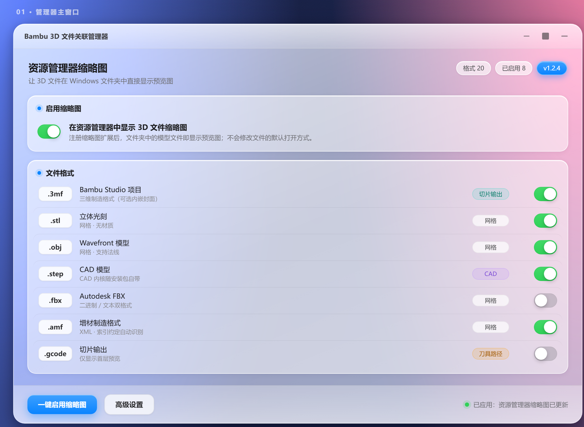

<div align="center">


# Bambu 3D 文件关联管理器

**让 Windows 资源管理器直接显示 3MF / STL / OBJ / STEP 等 3D 打印文件的缩略图预览。**

原生 Win32 · 完全离线 · 免费提供

[](https://github.com/starxxy/bambu3d-assoc)
[](https://github.com/starxxy/bambu3d-assoc/releases)
[](#许可与著作权)
[](#为什么值得信任)

</div>

---

## 这是什么

Windows 默认不认 3D 打印文件——`.3mf`、`.stl`、`.step` 在资源管理器里全是白板图标，找文件只能靠文件名猜。

**Bambu 3D 文件关联管理器**给这些格式注册一个**缩略图处理器**，让资源管理器像显示图片那样直接显示模型预览；同时提供一键启用/还原文件关联的管理界面。

- **原生 Win32**：单个 exe + 一个缩略图 DLL，启动即用，没有几百 MB 的运行时，不常驻后台
- **完全离线**：注册缩略图属于本地 COM 操作，程序不联网、不埋点、不上传任何文件
- **不抢默认打开方式**：只注册缩略图处理器，你双击 `.3mf` 还是打开你原来的程序
- **卸载干净**：还原全部扩展名关联，清空壳注册表键与缩略图缓存，不留残影

> 本程序是 **Bambu Studio** 的补充工具（补上它没做的缩略图预览），与拓竹科技（Bambu Lab）无隶属关系。

---

## 界面



自绘的「苹果毛玻璃」风格界面（DWM 圆角 + 半透明卡片），不含任何第三方 UI 框架。

---

## 支持的格式

| 分类 | 扩展名 |
|---|---|
| 3D 打印 | `3mf` `stl` `obj` `amf` |
| CAD | `step` `stp` |
| 切片 / 刀路 | `gcode` `g` `gco` |
| 其他网格 | `fbx` |

CAD 格式（STEP / STP）由安装包**自带的 OpenCASCADE（OCCT）内核**渲染，无需额外下载。

> v1.0.0 曾支持 `ply` `3ds` `off` `dae` `x3d` `wrl` `iges` `igs` `brep` `bgcode`
> 等 10 个扩展名，v1.1.0 起更换为「Bambu Studio 实际能打开的格式」。旧扩展名仍会在
> 安装/卸载时被清理，不会留下残迹。

---

## 下载安装

安装包放在本仓库 [`installers/1.3.0/`](installers/1.3.0/) 下，也可从
[Releases](https://github.com/starxxy/bambu3d-assoc/releases) 页面获取：

```
installers/1.3.0/Bambu3DAssoc-Setup-1.3.0.exe    12,249,557 字节
SHA-256: aa1d61f4124cbdc97575ac82d7c86198e2184216db8df5836895add207b8aed3
```

### 安装

双击运行，向导会问你安装范围：

| 选项 | 安装位置 | 注册表 | 权限 |
|---|---|---|---|
| **仅为我安装** | `%LOCALAPPDATA%\Programs\Bambu3DAssoc` | `HKCU` | 无需管理员 |
| **为所有用户安装** | `C:\Program Files\Bambu3DAssoc` | `HKLM` | 需要管理员 |

装完会自动应用一次关联，然后打开主界面——勾选想要的格式，点「应用」即可。

### 静默安装（批量部署）

```bat
:: 全系统安装
Bambu3DAssoc-Setup-1.3.0.exe /VERYSILENT /ALLUSERS

:: 仅当前用户
Bambu3DAssoc-Setup-1.3.0.exe /VERYSILENT /CURRENTUSER
```

> ⚠️ 静默安装**必须**显式指定 `/ALLUSERS` 或 `/CURRENTUSER`。只给 `/SUPPRESSMSGBOXES`
> 而不给范围时，Inno Setup 会采用「推荐」项（无管理员权限时可能选全系统安装而失败）。

---

## 卸载

三个入口任选其一：

1. **开始菜单** → `Bambu3DAssoc` 文件夹 → 「卸载 Bambu 3D 文件关联管理器」
2. **设置 → 应用 → 已安装的应用** → 搜索「Bambu 3D 文件关联管理器」
3. 直接运行 `{安装目录}\unins000.exe`

静默卸载：

```bat
unins000.exe /VERYSILENT
```

卸载器会自动完成全套清理，**不需要**先在程序里点「还原」：

- 先释放被 `dllhost.exe` / `prevhost.exe` 占用的缩略图 DLL（否则文件删不掉）
- 还原全部扩展名的文件关联（同时扫 `HKLM` 与 `HKCU`，覆盖新旧版本留下的记录）
- 删除空的 `ShellEx` 残留键、Explorer 的「打开方式」悬空记录
- 清空 Windows 缩略图缓存（`thumbcache_*.db`）——不清理的话，卸载后旧缩略图仍会显示
- 通知资源管理器立即刷新关联与图标状态

> **注意**：主界面里的「还原 & 卸载」按钮只做**关联还原**（还原文件关联 + 移除缩略图扩展），
> **不会删除程序文件**。要真正卸载程序，请用上面三个入口。

---

## 从源码构建

### 环境要求

- Windows 10/11 x64
- Visual Studio 2022（含「使用 C++ 的桌面开发」工作负载）
- CMake 3.20+
- OpenCASCADE（OCCT）—— 用于 CAD 格式渲染，见 `tools/build_occt_pack.ps1`

### 构建

```bash
cmake -S . -B build -G "Visual Studio 17 2022" -A x64
cmake --build build --config Release
```

产物在 `build/dist/`：`bs3d_assoc.exe`（管理器 GUI）+ `bs3d_thumb.dll`（缩略图 COM 扩展）。

### 打包安装器

先把 OCCT 内核解压到 `installer/occt/`，再用
[Inno Setup 6](https://jrsoftware.org/isinfo.php) 编译：

```bat
ISCC.exe installer\Bambu3DAssoc.iss
```

### 常见坑

- 编译前先清掉代理环境变量，否则 MSBuild 会报 `MSB6001`：

  ```bash
  unset http_proxy https_proxy all_proxy no_proxy HTTP_PROXY HTTPS_PROXY ALL_PROXY NO_PROXY
  ```

- `installer/occt/` 与 `build/` 不入库（体积大 / 可重建），首次构建需自行准备内核。

---

## 项目结构

```
├── installers/<版本>/          # 各版本安装包（唯一用户可见交付物）
├── src/                        # C++ 源码
│   ├── bs3d_assoc_main.cpp     # 管理器 GUI（自绘 UI）
│   ├── bs3d_thumb_dll.cpp      # 缩略图 COM 扩展（IThumbnailProvider）
│   ├── registry.cpp            # 文件关联读写
│   ├── thumbnailcore.cpp       # 缩略图渲染调度
│   ├── occplugin.cpp           # OpenCASCADE 内核加载
│   ├── rasterizer.cpp          # 网格光栅化
│   ├── protect.cpp             # 启动自检与完整性校验
│   └── ...                     # 解析器 / 缓存 / 工具
├── include/bs3d/               # 对外头文件
├── design/                     # 视觉稿（ui_draft_glassmorphism.html 是唯一真相）
├── tools/                      # 构建 / 校验 / 出图脚本
├── resources/                  # 图标资源
├── installer/Bambu3DAssoc.iss  # Inno Setup 6 打包脚本
├── CMakeLists.txt
└── CHANGELOG.md                # 完整版本历史
```

**取用历史版本快照：**

```bash
git checkout v1.2.4 -- installers/1.2.4/     # 只取该版安装包
git checkout v1.2.4                          # 切到该版源码快照
```

---

## 为什么值得信任

| 你可能担心的 | 实际情况 |
|---|---|
| 联网 / 上传文件 | **零网络**。缩略图是本地 COM 调用，程序不发起任何网络请求 |
| 抢占默认程序 | 只写 `ShellEx` 缩略图处理器，**不碰**扩展名默认打开方式 |
| 卸载残留 | v1.2.4 专门做了残留清理：空壳键、打开方式记录、缩略图缓存全清 |
| 注册表乱写 | 卸载时按 `HKLM` / `HKCU` 双根还原，并主动清扫历史版本的非标准 GUID |
| 是否收费 | **完全免费**，无试用期、无激活码、无功能阉割 |
| 会不会改我文件 | 只读文件来渲染缩略图，**从不修改**你的模型文件 |

---

## 版本历史

完整变更记录见 [CHANGELOG.md](CHANGELOG.md)。摘要：

| 版本 | 时间 | 主要内容 |
|---|---|---|
| **v1.3.0** | 2026-10-01 | **完全免费** + 品牌图标与署名 |
| v1.2.4 | 2026-09-29 | 卸载残留专项（空壳键 / 打开方式 / 缩略图缓存） |
| v1.2.3 | 2026-09-29 | 闪烁修复（双缓冲 + `WS_CLIPCHILDREN`） |
| v1.2.2 | 2026-09-29 | 安装范围移入向导；OCCT 内核改为必带 |
| v1.2.1 | 2026-09-29 | 回归系统标准窗口边框 |
| v1.2.0 | 2026-09-29 | 不再抢占默认打开方式 |
| v1.1.0 | 2026-09-28 | 格式集换代；OCCT 内核随包内置 |
| v1.0.0 | 2026-09-27 | 首个可用版本 |

---

## 许可与著作权

**本软件免费提供，但免费 ≠ 无主。著作权归 9号造物 所有。**

你**可以**：

- 免费下载、安装、使用（个人与商业用途均可）
- 原样传播本安装包，注明出处

你**不可以**：

- 反编译、逆向工程、修改后二次分发
- 去除或篡改作者署名、官方渠道链接、版权声明
- 将本软件或其衍生品用于倒卖、冒充原创

源码公开是为了便于审计与学习，**不构成**开源许可授权。详见 [LICENSE](LICENSE)。

> 注：`src/license.cpp` 是 v1.2.4 及更早版本「每日兑换码」付费机制的**退役代码**，
> 自 v1.3.0 起不参与编译；公开仓库中其中的密钥已脱敏，仅为保留实现结构作历史记录。

---

## 关于作者

**9号造物** — 3D 打印模型与工具的独立创作者。

| 平台 | 地址 |
|---|---|
| 哔哩哔哩 | [space.bilibili.com/50622066](https://space.bilibili.com/50622066) |
| MakerWorld 中国 | [makerworld.com.cn/zh/@9hao](https://makerworld.com.cn/zh/@9hao) |
| MakerWorld 国际 | [makerworld.com/@stary19](https://makerworld.com/@stary19) |

如果这个工具帮你省了时间，欢迎关注一下——那是继续做下去的最大动力。

---

<div align="center">
<sub>本作品由 9号造物 独立开发。</sub>
</div>
